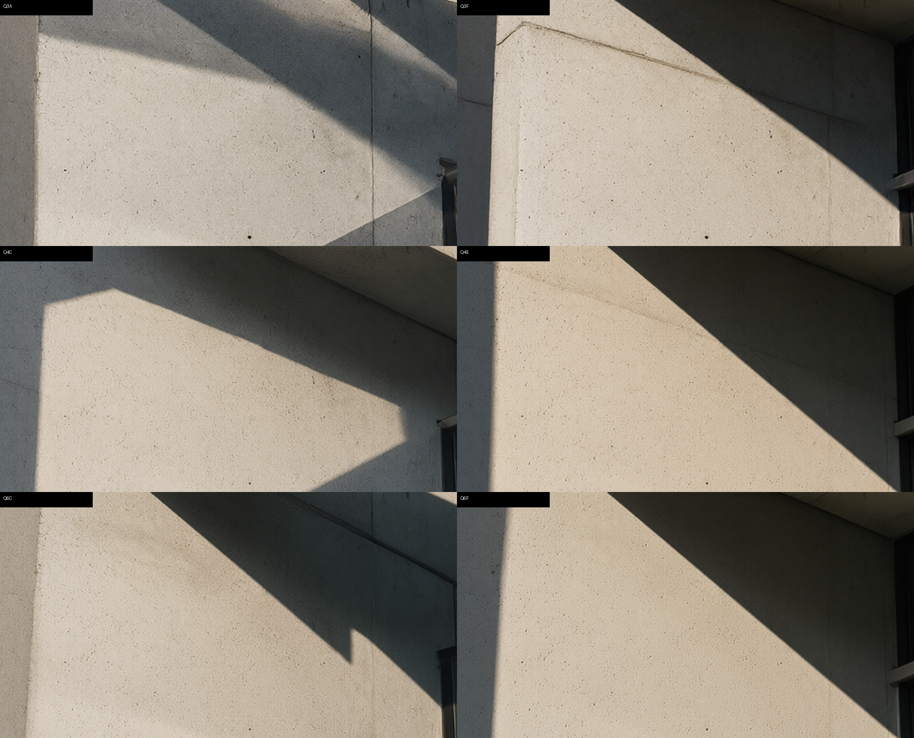

# LocModel Image Injector

[简体中文](README.zh-CN.md) | **English**

> A single-file web tool that talks directly to the `sd-server` engine (stable-diffusion.cpp) bundled with LocModel, bypassing the GUI's hard-coded parameters, injecting the *correct* sampling parameters per request — plus a measured, calibrated parameter preset for Qwen-Image 2.1 and mask-based local inpainting that the LocModel GUI does not provide.

- Version: v2.0 (Nov 2026)
- Form factor: **one HTML file — no install, no dependencies, no config residue**
- Engine: stable-diffusion.cpp (`sd-server.exe`, LocModel build `master-1050-58bb3c1-cuda`)
- Tested on: RTX 3060 Ti 8 GB / Windows 10 19045 / Qwen-Image 2.1 (Q3_K, Q4_K, Q6_K) + Qwen3-VL 8B text encoder
- Disclaimer: **Not an official LocModel project.** No affiliation with the LocModel authors. This tool only calls LocModel's local HTTP endpoints; it never modifies the LocModel installation directory or its config files.

---

## Table of Contents

- [Why this program exists](#why-this-program-exists)
- [Three things worth stating clearly](#three-things-worth-stating-clearly)
- [Parameter optimization log (detailed)](#parameter-optimization-log-detailed)
- [Final calibrated parameters](#final-calibrated-parameters)
- [Features](#features)
- [Usage](#usage)
- [Masked inpainting in depth](#masked-inpainting-in-depth)
- [Engine API contract](#engine-api-contract)
- [Known limits and pitfalls](#known-limits-and-pitfalls)
- [Repository structure](#repository-structure)
- [Reference documents](#reference-documents)

---

## Why this program exists

The origin is very concrete. Rendering a portrait with **Qwen-Image 2.1 Q3_K** inside LocModel, with a perfectly normal prompt, produced images that looked like they were *printed on watercolor paper* — lifted blacks, hair strands and skin micro-texture smeared away, contours bleeding outward. On the same machine with the same prompt, Z-Image Turbo Q4_K came out crisp.

The investigation concluded: **the main culprit was neither the model nor the prompt — it was the parameters LocModel's built-in workflow was sending to Qwen-Image 2.1.**

Reading the SDCPP parameters embedded in the PNGs (from the same LocModel version's history records):

| Field | Qwen-Image **2.0** | Qwen-Image **2.1** | Verdict |
|---|---|---|---|
| `scheduler` | `discrete` (shown as Normal) | **`flux`** | 2.1 got an extra flux scheduler layer |
| `flow_shift` | **`3.0` (explicitly sent)** | **missing, not sent at all** | A critical field silently dropped |
| `guidance.txt_cfg` | 2.5 | **6.0** | Not exposed in the GUI, stuck at the wrong value |
| `guidance.distilled_guidance` | 3.5 | 3.5 | Applied globally, not per-architecture |
| `sample_steps` | 20 | 20 | — |

Three defects compounding:

1. **`flow_shift` missing.** Qwen-Image 2.0/2.1 are flow-matching architectures; `flow_shift` shapes the noise schedule curve. When the default does not match the training distribution, the sampling trajectory drifts and manifests as *under-denoising* — residual noise lifts the shadows while detail never forms.
2. **`scheduler` remapped to `flux`.** The official stable-diffusion.cpp example for Qwen-Image 2.1 is `--steps 20 --cfg-scale 6.0 --sampling-method euler`, **without `--flow-shift` and without specifying a scheduler**, i.e. it uses the engine default. LocModel actively added a flux scheduler — an extra, unrequested deviation.
3. **`txt_cfg` locked at 6.0 with no way to change it.** Measurements below show 6.0 is the dirtiest, blurriest setting available and runs 2.3× slower than the correct value. Worse, the LocModel GUI offers **no control at all** for this field, and none for `scheduler` / `flow_shift` either (the field names exist inside the exe, but no option strings such as `discrete`/`karras`) — the only way to fix it is from the outside.

Hence this tool: **no editing of LocModel's install directory, no touching its `settings.json`, no waiting for upstream updates** — it simply overrides the `sample_params` fields at the moment the request is sent.

Supporting evidence — patching the config was a dead end. In LocModel's `settings.json`, `custom_args` is a **single global dictionary** (no per-model keys), and GUI defaults come from an embedded catalog plus remote payloads. Per-model isolation is impossible, and "restore on close" is impossible. The final architecture is therefore **Mode A: request-level injection over direct HTTP to `sd-server`.**

---

## Three things worth stating clearly

### ① LocModel's built-in workflow sends wrong parameters to Qwen-Image 2.1 — this is the primary reason the project exists

Specifically three fields: `flow_shift` never sent, `scheduler` mis-mapped to `flux`, `txt_cfg` pinned at 6.0 with no UI to change it (plus `distilled_guidance` applied globally at 3.5 regardless of architecture). This is not a matter of taste — it is a reproducible, measurable configuration defect. With the same seed, changing only `txt_cfg` from 6.0 to 1.6 moves the image from "grey + dirty + blurry" to "solid blacks, legible texture, crisp edges", while cutting render time from ~120 s to ~55 s.

### ② The parameters were optimized item by item, with quantitative comparison at every step

These are not hand-picked "values that look nice". The result of **19 single-variable control experiments + objective metric measurement + 100% crop blind review**, cross-validated across: scheduler (`default(auto)` / `discrete`), `flow_shift` (absent / 1.5 / 3.0), steps (20 / 28), `txt_cfg` (1.0 / 1.3 / 1.6 / 2.0), quantization tier (Q3_K / Q4_K / Q6_K), `distilled_guidance` (3.5 / 0), and VAE device (CPU / GPU).

Two popular hypotheses were also **disproved** along the way:
- "Higher quantization tiers get pushed out of VRAM, causing degradation" — disproved by MD5 byte-level comparison (VAE on CPU vs GPU produces identical output);
- "`distilled_guidance=0` saves compute" — it triggers an engine degenerate path; 20-step total time exploded from 55 s to 726 s (13×).

Full data: [Three-tier calibration report](docs/zh/04-three-tier-calibration.md) and [Quantization comparison](docs/zh/03-quantization-comparison.md) (Chinese).

### ③ Added masked region selection for inpainting — something the LocModel GUI cannot do at all

LocModel GUI's edit mode is whole-image only: **no canvas, no brush, no mask.** If you want to change one hand or one window frame, you have to regenerate the entire image and everything else drifts with it. This project fills that gap:

- Paint a region on the canvas (rectangle / ellipse / free brush / lasso; composable, invertible, featherable)
- Live mask coverage readout plus connected-component self-check (warns when the mask fragments into isolated specks)
- Region statistics (dominant color / mean luminance / contrast, sampled over 102,400 px) to help you write the prompt
- Sobel edge analysis proposes candidate boxes, applicable in one click
- **Out-of-mask pixel protection**: after the engine returns a full image, compositing happens on the CPU against the mask; measured out-of-mask pixel difference is **0** (verified pixel-by-pixel), and the engine's raw output is preserved as `*_raw.png` for traceability

---

## Parameter optimization log (detailed)

### Controlled conditions

| Item | Value |
|---|---|
| Engine | stable-diffusion.cpp `58bb3c1` (LocModel `master-1050-58bb3c1-cuda` bundled `sd-server.exe`), dedicated instance on port 8899 |
| Models | `qwen_image_2.1-Q3_K.gguf` (3.05 GB) / `-Q4_K.gguf` (3.91 GB) / `-Q6_K.gguf` (5.59 GB) |
| VAE | `qwen_image_2.1_vae_bf16.safetensors` |
| Text / vision encoder | `Qwen3VL-8B-Instruct-Q4_K_M.gguf` + `mmproj-Qwen3VL-8B-Instruct-F16.gguf` |
| Fixed | same prompt, `seed=1090474679`, 1344×768 (`size_multiple=32`), sampler `euler`, `eta=0.0`, `distilled_guidance=3.5` |
| Hardware | RTX 3060 Ti 8 GB / Windows 10 19045 |

### Metric definitions (why "looks sharper" is not evidence)

Objective sharpness metrics are inflated by quantization noise, so judgment leans on structure-to-noise ratio, always paired with a 100% crop blind review:

| Metric | Meaning | Reading |
|---|---|---|
| `mid` | Mid-frequency energy share (%) — skin micro-structure, material texture | Higher = more real structure |
| `snr` | `mid` / `noise` | **Primary metric**; resists "sharpness faked by noise" |
| `gP99` | 99th-percentile gradient — edge contrast | Higher = crisper contours |
| `p1` | 1st-percentile luminance — shadow black level | **Lower = less haze** |
| `sat` | Mean saturation | Photorealistic range ≈ 0.18–0.22 |
| `noise` | Median std-dev inside dark blocks | Lower = cleaner |

### Stage 1 — Scheduler and `flow_shift` (cfg fixed at 1.0)

| case | Model | scheduler | flow_shift | steps | mid | snr | gP99 | p1 | sat | noise |
|---|---|---|---|---|---|---|---|---|---|---|
| Q3A | Q3_K | default(auto) | — | 20 | 2.04 | 76.8 | .1951 | .0891 | .1384 | .02655 |
| Q3B | Q3_K | discrete | 3.0 | 20 | 1.82 | 81.7 | .1906 | .0710 | .1491 | .02228 |
| Q3C | Q3_K | discrete | 3.0 | 28 | 1.99 | 88.5 | .2029 | .0650 | .1526 | .02249 |
| Q3D | Q3_K | discrete | **1.5** | 20 | 2.21 | 75.4 | .1972 | .0930 | .1371 | .02930 |
| Q4A | Q4_K | default(auto) | — | 20 | 1.67 | 74.0 | .1611 | .0997 | .1265 | .02256 |
| Q4B | Q4_K | discrete | 3.0 | 20 | 1.36 | 72.0 | .1529 | .0868 | .1463 | .01888 |
| Q4C | Q4_K | discrete | 3.0 | 28 | 1.34 | 69.1 | .1610 | .0874 | .1497 | .01939 |
| Q6A | Q6_K | default(auto) | — | 20 | 1.76 | 70.5 | .1756 | .0999 | .1484 | .02495 |
| Q6B | Q6_K | discrete | 3.0 | 20 | 1.43 | 78.7 | .1722 | .0908 | .1456 | .01816 |
| Q6C | Q6_K | discrete | 3.0 | 28 | 1.63 | 84.7 | .1788 | .0855 | .1722 | .01924 |

**Findings**
1. `discrete + flow_shift 3.0` **consistently** improves SNR across all three tiers (+10%–22% vs `default(auto)`) and pushes shadow `p1` down (.0891→.0650 / .0997→.0874 / .0999→.0855) — i.e. visibly less haze.
2. `flow_shift 1.5` (Q3D) is the worst of the set: `snr` only 75.4, highest noise — a low shift treats noise as detail and makes the image dirtier.
3. 28 steps generally beats 20 (`snr`: Q3 81.7→88.5, Q6 78.7→84.7) at roughly +40% time cost.

### Stage 2 — `txt_cfg` sweep (discrete + shift 3.0 + 28 steps)

| case | Model | cfg | mid | snr | gP99 | p1 | sat | noise |
|---|---|---|---|---|---|---|---|---|
| Q3C | Q3_K | 1.0 | 1.99 | 88.5 | .2029 | .0650 | .1526 | .02249 |
| Q3E | Q3_K | 1.3 | 1.78 | 78.6 | .2044 | .0494 | .1596 | .02266 |
| **Q3F** | **Q3_K** | **1.6** | **1.79** | **109.3** | **.2043** | **.0357** | **.1823** | **.01640** |
| Q4C | Q4_K | 1.0 | 1.34 | 69.1 | .1610 | .0874 | .1497 | .01939 |
| Q4D | Q4_K | 1.3 (20 steps) | 1.49 | 94.7 | .1702 | .0536 | .1812 | .01573 |
| **Q4E** | **Q4_K** | **1.6** | **1.59** | **109.5** | **.1766** | **.0367** | **.2257** | **.01452** |
| Q4F | Q4_K | 2.0 | 1.59 | 118.1 | .1930 | .0300 | .2696 | .01346 |
| Q6C | Q6_K | 1.0 | 1.63 | 84.7 | .1788 | .0855 | .1722 | .01924 |
| Q6D | Q6_K | 1.3 | 1.24 | 63.7 | .1714 | .0489 | .1662 | .01946 |
| Q6E | Q6_K | 1.3 (20 steps) | 1.63 | 79.7 | .1800 | .0521 | .1696 | .02044 |
| **Q6F** | **Q6_K** | **1.6** | **1.61** | **97.9** | **.2017** | **.0346** | **.2022** | **.01640** |

**Findings**
1. Raising `cfg` from 1.0 to 1.6 lifts SNR in all three tiers (Q3 88.5→109.3, Q4 69.1→109.5, Q6 84.7→97.9), cuts noise by 24%–28%, and presses shadow `p1` from 0.065–0.087 down to ≈0.035. **Low cfg is the actual cause of "grey + dirty"; "cfg=1.0 is the official default" does not mean "cfg=1.0 is optimal".**
2. Going further to 2.0 (Q4F) raises `snr` again, but saturation shoots to 0.2696 — well outside the photorealistic range, with hard-edge artifacts beginning to appear. Judged **overshoot**.
3. **`cfg=1.6` is the shared optimum across all three tiers**: saturation lands in 0.18–0.23, shadow `p1` ≈0.035, `snr` at or near the tier's best.
4. Q4_K benefits most from cfg compensation (at cfg 1.0 its `snr` is only 69.1 and `mid` only 1.34), indicating this tier's quantization error shows up mainly as lost contrast and detail energy.
5. Q6_K showed a `mid` collapse at `cfg=1.3` (Q6D: 1.24) but recovered to 1.61 when rerun at `cfg=1.6` — Q6D is an outlier caused by VRAM contention, not a trend.

### Stage 3 — Quantization tier head-to-head (unified at cfg 1.6 / 28 steps / discrete / shift 3.0)

| Tier | mid | snr | gP99 | p1 | sat | noise | Time per image | Character |
|---|---|---|---|---|---|---|---|---|
| Q3_K (3.05 GB) | 1.79 | 109.3 | .2043 | .0357 | .1823 | .01640 | ~55 s | High structural energy, strong perceived sharpness, slight quantization grain |
| Q4_K (3.91 GB) | 1.59 | 109.5 | .1766 | .0367 | .2257 | .01452 | ~95 s | Cleanest but softest; saturation runs high |
| Q6_K (5.59 GB) | 1.61 | 97.9 | .2017 | .0346 | .2022 | .01640 | ~175 s | Firmest edges, most natural color, highest detail fidelity |

**Conclusion**: after calibration the tiers converge noticeably (`mid` 1.59–1.79, `snr` 98–110). **Q3_K is the best value** (about 90% of the quality at one third of the time); Q6_K still wins on color naturalness and edge quality; Q4_K's low `mid` means it must be paired with "blurry / smeared / soft-focus / missing detail" negatives or it goes limp.



### The decisive number: fixing CFG matters an order of magnitude more than changing tier

| Comparison | Variable | SSIM | MAE | Verdict |
|---|---|---|---|---|
| A vs F | Tier only Q3_K→Q4_K (cfg 6) | 0.9289 | 17.00 | Highly similar |
| C vs E | Tier only Q3_K→Q4_K (cfg 1) | 0.9027 | 16.97 | Highly similar |
| C vs H | Tier only Q3_K→Q6_K (cfg 1) | 0.8895 | 17.68 | Perceptible |
| **A vs C** | **CFG only 6.0→1.0** | **0.6496** | **40.95** | **Markedly different** |
| C vs K | Same params rerun (reproducibility) | **1.0000** | **0.00** | Identical |

**The magnitude of tier-to-tier difference is only ~41% of the CFG difference (MAE 17 vs 41).** In other words: before agonizing over which quant to download, fix `txt_cfg`. That is precisely why this project exists.

### Hypotheses that were disproved (time savers)

| Hypothesis | Experiment | Result |
|---|---|---|
| Higher tiers spill out of VRAM → VAE offload → degradation | Forced Q4_K to keep VAE in VRAM and rerun (E vs L) | **Identical MD5** (`c8fc3499…`); VAE device does not affect pixels at all. 100% of the difference comes from the quantized weights |
| `distilled_guidance=0` saves compute | 4-step probe + full 20-step run | Probe finished in 51 s looking fine; the 20-step run spent **661 s** in `latent decoded`, **726 s** total (13×). An engine degenerate path → **do not use; keep 3.5** |
| The injection channel itself may add nondeterminism | Two same-param same-seed reruns | Same MD5, SSIM 1.0000, MAE 0.00 → **fully deterministic**, usable as a regression baseline |
| 8 GB VRAM can run batches back to back | Continuous multi-batch run | Degrades to `859 s/it` (VRAM fragmentation) → **restart `sd-server` between batches** |

### Methodology notes (why this data can be trusted)

1. **Never trust a single objective sharpness metric**: Laplacian variance and gradient p99 are both inflated by quantization noise (group A once scored highest on all three sharpness metrics while looking the dirtiest). Read `mid/noise` first, then do a magnified blind review; only conclude when both agree, and when they disagree, defer to the 100% crop while recording the conflict.
2. **Eliminate confounders at the bit level**: anything MD5 can settle should not be inferred from metrics.
3. **Normalize magnitudes before comparing**: the value of SSIM/MAE lies not in absolute numbers but in relative magnitude across variables — it tells you which knob to turn.
4. **A fast probe can only falsify, never confirm**: any suspicious parameter that passes a probe must be rerun at full step count before adoption (`dg=0` slipped through exactly this way).
5. **Diagnose timing anomalies by log segments**: `generate_image completed` is just a total; the real evidence is in `generating N latent images completed` and `latent decoded`. Here, the absurd split of 50 s sampling vs 661 s decoding is what located the degenerate path in decoding rather than sampling.

---

## Final calibrated parameters

All three tiers share the same sampling settings; only the negative prompt differs.

| Parameter | Value |
|---|---|
| sampler | `euler` |
| scheduler | **`discrete`** |
| flow_shift | **`3.0`** |
| sample_steps | **`28`** |
| txt_cfg | **`1.6`** |
| distilled_guidance | `3.5` (default — **never 0**) |
| eta | `0.0` |
| Resolution | 1344×768 (`size_multiple=32`) |

| Tier | Recommended cfg | Extra negatives | Time per image (28 steps) |
|---|---|---|---|
| Q3_K (3.05 GB) | 1.6 | 颗粒、噪点、脏色、斑驳 (grain, noise, dirty color, mottling) | ≈55 s |
| Q4_K (3.91 GB) | 1.6 | 模糊、涂抹、柔焦、细节缺失 (blur, smear, soft focus, missing detail) | ≈95 s |
| Q6_K (5.59 GB) | 1.6 | none needed | ≈175 s |

Base negative prompt (all tiers):

```
模糊，水彩纸纹，灰雾，低对比，过曝，噪点，涂抹感，失真
(blurry, watercolor paper grain, grey haze, low contrast, overexposed, noise, smeared, distorted)
```

The edit (inpainting) channel defaults to **Q4_K**: Q3_K lacks detail and Q6_K takes well over ten minutes per image, so Q4_K is the time/quality compromise; its softness tendency is offset by auto-appending "blur, smear, soft focus, missing detail".

---

## Features

### Three modes

| Mode | Description | Engine usage |
|---|---|---|
| Text-to-image | Prompt only | `POST /sdcpp/v1/img_gen` with fully injected `sample_params` |
| Reference image-to-image | Up to 4 reference images steer composition/style | `ref_images` (base64 dataURL; mutually exclusive with `init_image`) |
| Masked inpainting | Repaint only the painted region, protect everything else | `init_image` + `mask_image` + `strength` |

### Parameter panel

- Automatic port probing (tries 8790 / 8686 / 8899 / 8080 / 7860 / 1234 / 9090 / 5000 in turn; locks on to whichever answers `/sdcpp/v1/capabilities`)
- Panel fields are generated dynamically from `capabilities.defaults_by_mode` — nothing hard-coded
- Three-level parameter restore:
  - **L1 engine raw default** (e.g. `txt_cfg=7.0`, flagged in red as "this value is wrong")
  - **L2 official recipe default** (`txt_cfg=1.0`)
  - **L3 measured recommendation** (`txt_cfg=1.6` + `discrete` + `shift 3.0` + 28 steps)
- Resolution auto-validated against `size_multiple` (32)
- Negatives auto-appended per quantization tier

### Gallery integration

After granting File System Access API permission for your image folder and `AppData\Local\LocModel`, one generation writes:

- the main image (composited, protected)
- `*_raw.png` (raw engine output, for traceability)
- `*_mask.png` (the mask used, for reproducibility)
- and appends one record to the `images.json` index: five new fields (`mode`, `strength`, `mask_coverage`, `recomposed`, `ref_count`) while **all 14 native fields are preserved verbatim**, so LocModel itself keeps working

> Note: if LocModel's GUI is running while you write the index, restart the GUI to see the new images in its own gallery.

---

## Usage

### 1. Prerequisites

1. Install and run **LocModel**, ensuring its bundled engine is ready (LocModel keeps `sd-server.exe` under `AppData\Local\LocModel\engines\sd\`).
2. Use a **Chromium-based browser** (Chrome / Edge) — gallery writing relies on the File System Access API, which Firefox/Safari do not support.

### 2. Launch

Just open the single HTML file in this repo. No installation, no Node/Python runtime:

- Latest: [`injector/LocModel-Injector-v2.0.html`](injector/LocModel-Injector-v2.0.html)
- Legacy: [`injector/LocModel-Injector-v1.0.html`](injector/LocModel-Injector-v1.0.html)

### 3. Connect to the engine

1. Click "Probe / Connect"; the tool probes candidate ports concurrently and, on a hit, shows engine status, loaded model and available fields.
2. If LocModel is running, connect to its hosted instance (usually 8790). To stay fully isolated from the GUI, start a dedicated instance:

```
sd-server.exe ^
  --listen-ip 127.0.0.1 --listen-port 8899 ^
  --model-dir F:\AI-Models\image ^
  --diffusion-model F:\AI-Models\image\qwen-image-2.1\qwen_image_2.1-Q3_K.gguf ^
  --llm F:\AI-Models\image\common\Qwen3VL-8B-Instruct-Q4_K_M.gguf ^
  --llm_vision F:\AI-Models\image\common\mmproj-Qwen3VL-8B-Instruct-F16.gguf ^
  --vae F:\AI-Models\image\common\qwen_image_2.1_vae_bf16.safetensors ^
  --diffusion-fa --backend te=cpu,vae=cpu ^
  -W 1024 -H 1024 ^
  --lora-model-dir F:\AI-Models\image\loras
```

> `--llm` and `--llm_vision` are mandatory; without them the engine exits immediately due to a missing text encoder. `--backend te=cpu` keeps text/vision encoding on the CPU (saves VRAM, slower inpainting); with VRAM to spare, moving VAE back to the GPU cuts decode from ~175 s to ~4 s (**pixel output unchanged — MD5-verified**).

### 4. Generate

1. Pick a mode (text-to-image / reference / inpainting).
2. Enter a prompt and select a quantization preset (which auto-fills cfg, negatives and a time estimate).
3. Adjust as needed (steps, size, seed, strength).
4. Click Generate — the tool submits asynchronously and polls `/sdcpp/v1/jobs/<id>`, then previews the result.
5. Click Download, or Save to gallery (requires a granted directory).

### 5. Verify the parameters actually took effect

After generation, inspect the PNG's embedded `parameters` metadata (latin1-decode it, then decode as UTF-8) and confirm `txt_cfg`, `scheduler` and `flow_shift` are what you set. This is the only hard evidence that injection succeeded.

---

## Masked inpainting in depth

This is the capability LocModel's GUI lacks, and the focus of v2.0.

### Canvas tools

| Tool | Purpose |
|---|---|
| Rectangle / Ellipse | Quickly select faces, windows, furniture and other regular regions |
| Free brush | Precisely paint hair strands, fingers and other irregular areas; brush size adjustable |
| Lasso | Trace a polygon along an object's contour |
| Invert | One click to switch between "repaint inside" and "repaint outside" |
| Feather | Edge transition width in pixels, avoiding hard seams |

Selections stack. Mask polarity follows the engine convention: **white = repaint, black = keep**.

### Three assistants (new in v2.0)

| Feature | Purpose |
|---|---|
| **Connected-component check** | Counts mask components and warns if the mask fragments into isolated specks (specks cause spotty, dirty inpainting). Measured: a rectangle over the same region covered 8.99%, while brushing to 9.94% consolidated the components and clearly improved edge quality |
| **Selection statistics** | Samples 102,400 px in the selection and reports dominant color, mean luminance and contrast — directly usable to write "change it to this color / this lighting" instead of guessing |
| **Sobel candidate boxes** | Runs Sobel edge analysis and proposes 4 candidate regions as one-click rectangles |

### Out-of-mask pixel protection (critical)

`/img_gen` returns a full image; writing it straight to disk also alters pixels you never selected (one measured case changed 800k+ pixels outside the mask). This project's pipeline:

```
engine full image → CPU compositing against the mask → keep only in-mask result
                                                    ├─ composited image (delivered)
                                                    ├─ *_raw.png (raw engine output)
                                                    └─ *_mask.png (mask used)
```

Live engine verification: **mean out-of-mask pixel difference = 0**, mean in-mask difference = 48.49; a 512×512 inpaint took ~60 s (strength 0.85, steps 24, mask coverage 23.69%).

### Reference image constraints

- **4 images maximum** (extra ones are rejected with a notice)
- `ref_images` and `init_image` / `end_image` are **mutually exclusive**
- Annotation color can optionally be burned into the reference image (`burn` on by default; off leaves it untouched)

---

## Engine API contract

| Endpoint | Method | Purpose |
|---|---|---|
| `/sdcpp/v1/capabilities` | GET | Current mode and the full `defaults_by_mode` field template (~5,933 bytes on this machine) |
| `/sdcpp/v1/recipes` | GET | Per-model recipe defaults and `effective_features` |
| `/sdcpp/v1/models/status` | GET | `state` and loaded models |
| `/sdcpp/v1/img_gen` | POST | Submit a generation job (async, returns a job id) |
| `/sdcpp/v1/jobs/<id>` | GET | Poll job status and base64 results |

Field format gotchas:

- Image fields `init_image` / `mask_image` / `control_image` / `ip_adapter_image` / `end_image` are `string|null`; `ref_images` is `string[]`. Values must be **base64 dataURLs**; passing a local path or an object returns `400 invalid generation parameters`.
- `txt_cfg`, `flow_shift` and `scheduler` inside `sample_params` can be switched at runtime **without swapping GGUF**; the quantization tier itself cannot be changed at runtime.
- In command-line mode `runtime_recipe.id = @command-line`, there is **no recipe fallback**; engine defaults are `cfg 7.0 / flow_shift auto`, so `txt_cfg` and `flow_shift` must be passed explicitly.
- Set the polling timeout to ≥1800 s (the inpaint channel under `te=cpu` measured 267–556 s; the original 900 s timeout causes false failures on slow paths).

---

## Known limits and pitfalls

| Limit | Note |
|---|---|
| Chromium only | Gallery writing depends on the File System Access API |
| CORS | The engine must allow cross-origin requests (OPTIONS preflight verified working; if blocked, enable it via `--cors` or equivalent) |
| Slow because of CPU encoding | Under `--backend te=cpu`, text/vision encoding on the CPU is the root cause of slow inpainting (267 s / 556 s), not slow rendering |
| VRAM fragmentation | On 8 GB cards, back-to-back batches degrade to `859 s/it` — **restart `sd-server` between batches** |
| `distilled_guidance=0` | Forbidden. Triggers a VAE decode degenerate path; 726 s total |
| `flow_shift=1.5` | Not recommended. Noise treated as detail; `snr` only 75.4 |
| `cfg=2.0` | Overshoot. Saturation 0.2696, outside the photorealistic range |
| Color side effect | Dropping cfg from 6.0 to 1.6 lowers overall saturation; compensate in the prompt or with +15–25 in post |
| Not covered | Q8_0 untested (8 GB cards offload heavily); multi-seed stability validation pending |
| Version coupling | Depends on LocModel's bundled engine HTTP contract; major LocModel upgrades may change fields, requiring re-alignment against `capabilities` |

---

## Repository structure

```
LocModel-Image-Injector/
├── README.md                      # English (this file)
├── README.zh-CN.md                # Simplified Chinese
├── injector/
│   ├── LocModel-Injector-v2.0.html    # Latest (single file, zero dependency)
│   └── LocModel-Injector-v1.0.html    # Legacy, kept for reference
└── docs/
    ├── images/
    │   └── calibration-comparison.png # Three-tier comparison (2× crop, same region)
    └── zh/
        ├── 01-root-cause-analysis.md        # Root-cause analysis and fix plan
        ├── 02-param-injection-validation.md # Parameter injection validation
        ├── 03-quantization-comparison.md     # Quantization comparison and best config
        ├── 04-three-tier-calibration.md      # Three-tier calibration (19 runs, full data)
        ├── 05-requirements-analysis.md       # Requirements and architecture decision
        └── 06-v2-upgrade-plan.md             # v2.0 upgrade plan
```

---

## Reference documents

| Document | Content |
|---|---|
| [Root-cause analysis](docs/zh/01-root-cause-analysis.md) | Reverse-engineering GUI gaps from embedded PNG parameters, field-by-field comparison of 2.0/2.1/Z-Image, spectral and sharpness measurements |
| [Injection validation](docs/zh/02-param-injection-validation.md) | Feasibility of the injection channel and evidence that fields take effect |
| [Quantization comparison](docs/zh/03-quantization-comparison.md) | SSIM/MAE normalized comparison, blind-review conclusions, disproved hypotheses |
| [Three-tier calibration](docs/zh/04-three-tier-calibration.md) | All 19 runs and the final parameter set |
| [Requirements analysis](docs/zh/05-requirements-analysis.md) | Why request-level HTTP injection instead of editing config |
| [v2.0 upgrade plan](docs/zh/06-v2-upgrade-plan.md) | Masked inpainting, connected-component check, selection stats, Sobel candidates — design and acceptance criteria |

*(Reference documents are in Chinese; translations can be contributed.)*

---

## Credits & disclaimer

- Thanks to [leejet/stable-diffusion.cpp](https://github.com/leejet/stable-diffusion.cpp) for the engine, and to LocModel for the local packaging and model management.
- This is a personal experiment with no warranty. Every parameter conclusion is based on a single seed measured on RTX 3060 Ti 8 GB + Qwen-Image 2.1 + SDCPP `58bb3c1`; results may differ on other GPUs, commits or seeds — please reproduce before relying on them.
- If these findings help you, consider reporting the missing `flow_shift` and the `scheduler` mapping issue to the LocModel authors. Once the GUI is fixed, masked inpainting would be this tool's only remaining reason to exist.
