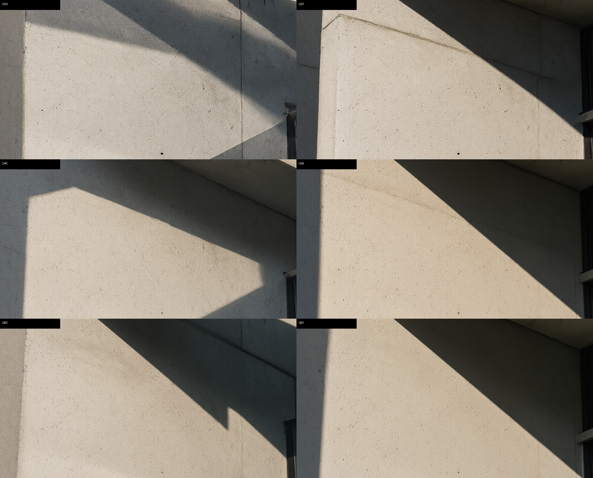

# LocModel Image Injector

**简体中文** | [English](README.md)

> 一个单文件网页工具，直连 LocModel 内置的 `sd-server`（stable-diffusion.cpp）引擎，绕过 GUI 的固定参数，把「正确的」采样参数按请求注入，并为 Qwen-Image 2.1 提供经过实测校准的参数预设与带遮罩的局部改图能力。

- 版本：v2.0（2026-11）
- 形态：**单个 HTML 文件，零安装、零依赖、零配置残留**
- 引擎：stable-diffusion.cpp（LocModel 内置 `master-1050-58bb3c1-cuda` 版 `sd-server.exe`）
- 实测环境：RTX 3060 Ti 8GB / Windows 10 19045 / Qwen-Image 2.1（Q3_K / Q4_K / Q6_K）+ Qwen3-VL 8B 文本编码器
- 声明：**非 LocModel 官方项目**，与 LocModel 作者无隶属关系；本项目只调用其本地 HTTP 接口，不修改其安装目录、不篡改其配置文件。

---

## 目录

- [为什么做这个程序（开发主因）](#为什么做这个程序开发主因)
- [三件必须说清楚的事](#三件必须说清楚的事)
- [参数优化比对过程（详细）](#参数优化比对过程详细)
- [定稿的最佳参数](#定稿的最佳参数)
- [功能特性](#功能特性)
- [使用方法](#使用方法)
- [遮罩局部改图详解](#遮罩局部改图详解)
- [引擎接口契约](#引擎接口契约)
- [已知限制与避坑](#已知限制与避坑)
- [仓库结构](#仓库结构)
- [参考文档](#参考文档)

---

## 为什么做这个程序（开发主因）

起因很具体：在 LocModel 里用 **Qwen-Image 2.1 Q3_K** 出一张人像，提示词正常，出来的图却像「印在水彩纸上」——暗部发灰、发丝和皮肤纹理全部糊掉、轮廓像被水洇开。同一台机器、同一提示词，换 Z-Image Turbo Q4_K 出图却锐利扎实。

排查结论是：**问题主要不在模型，也不在提示词，而在 LocModel 内置工作流给 Qwen-Image 2.1 下发的参数是错的。**

从两张样图 PNG 内嵌的 SDCPP 参数里直接读出的差异（同一版本 LocModel 的历史记录）：

| 字段 | Qwen-Image **2.0** | Qwen-Image **2.1** | 判定 |
|---|---|---|---|
| `scheduler` | `discrete`（界面显示 Normal） | **`flux`** | 2.1 被额外套了一层 flux 调度 |
| `flow_shift` | **`3.0`（显式传入）** | **缺失，未下发** | 2.1 直接漏掉了这个关键字段 |
| `guidance.txt_cfg` | 2.5 | **6.0** | GUI 不透传、用户无法修改，长期以错值运行 |
| `guidance.distilled_guidance` | 3.5 | 3.5 | 未按架构区分，全局塞给 Qwen |
| `sample_steps` | 20 | 20 | — |

三处硬伤叠加的后果：

1. **`flow_shift` 缺失**。Qwen-Image 2.0/2.1 都是 flow-matching 架构，`flow_shift` 决定噪声调度曲线的形态；缺省值与训练分布不匹配时采样轨迹偏离，表现为「去噪不足」——残余噪声抬高暗部、细节来不及成形。
2. **`scheduler` 被改成 `flux`**。官方 stable-diffusion.cpp 的 Qwen-Image 2.1 示例命令为 `--steps 20 --cfg-scale 6.0 --sampling-method euler`，**不带 `--flow-shift`、也不指定 scheduler**，即走引擎默认调度；LocModel 主动套一层 flux 属于额外引入的偏移。
3. **`txt_cfg` 被锁死在 6.0 且不可改**。实测 6.0 是「最脏最糊」的取值（下文有数据），且耗时是正解的 2.3 倍。更麻烦的是：LocModel GUI **没有任何入口**可以修改这个字段，连 `scheduler` / `flow_shift` 也没有选项（exe 内只存在字段名，无 `discrete/karras` 等选项串）——想改只能从外部绕。

于是就有了这个工具：**不改 LocModel 安装目录、不碰它的 `settings.json`、不需要它更新**，只在发请求的那一刻，把正确的 `sample_params` 逐字段覆盖上去。

补充证据：改配置这条路走不通。LocModel 的 `settings.json` 里 `custom_args` 是**全局单一字典**（无 per-model 分键），GUI 默认参数来自内嵌 catalog 与远端下发，既无法做到 per-model 隔离，也无法做到「关闭即还原」。所以最终方案定为 **A 模式：运行时经 HTTP 直连 sd-server 做请求级注入**。

---

## 三件必须说清楚的事

### ① LocModel 内置工作流对 Qwen-Image 2.1 的参数设置有误，是本项目开发的主要原因

具体是三个字段：`flow_shift` 未下发、`scheduler` 错映射为 `flux`、`txt_cfg` 被锁在 6.0 且无修改入口（另有 `distilled_guidance` 全局填 3.5 未按架构区分）。这不是「审美差异」，而是可复现、可量化的配置缺项：同一 seed 下仅把 `txt_cfg` 从 6.0 改到 1.6，画面从「灰+脏+糊」回到「暗部实、纹理清、边缘锐」，同时单张耗时从约 120 s 降到约 55 s。

### ② 调整过程中对模型参数做了详细的逐项优化与量化比对

不是拍脑袋给一组「看起来很美」的参数，而是 **19 组单变量对照实验 + 客观指标测度 + 100% 裁切盲评** 三层交叉验证，覆盖：调度器（`default(auto)` / `discrete`）、`flow_shift`（不传 / 1.5 / 3.0）、步数（20 / 28）、`txt_cfg`（1.0 / 1.3 / 1.6 / 2.0）、量化档（Q3_K / Q4_K / Q6_K）、`distilled_guidance`（3.5 / 0）、VAE 设备（CPU / GPU）。

过程中还**否证了两个流行假设**：
- 「高量化档被挤出显存导致画质劣化」——用 MD5 字节级对照否证（VAE 在 CPU 与 GPU 下输出完全一致）；
- 「`distilled_guidance=0` 可以省算力」——实测触发引擎退化路径，20 步总耗时从 55 s 暴涨到 726 s（13 倍）。

完整数据见 [三档量化校准报告](docs/zh/04-three-tier-calibration.md) 与 [量化对照与最佳方案](docs/zh/03-quantization-comparison.md)。

### ③ 增加了 LocModel GUI 改图完全不具备的能力：遮罩圈选修改区域

LocModel GUI 的「改图」只能整图处理，**没有画布、没有画笔、没有遮罩**——你想只改人物的一只手、只换一扇窗的材质，做不到，整张图都得重绘，没改的地方也跟着变。本项目补上了这块：

- 在画布上任意圈选要修改的区域（矩形 / 椭圆 / 自由画笔 / 套索，可叠加、可反选、可羽化）
- 实时显示遮罩覆盖率，并对选区做连通域自检（提示是否散落成孤立碎片）
- 对选区采样统计主色 / 亮度 / 对比度，直接辅助你写提示词
- Sobel 边缘分析自动给出候选区域建议框，一键套用
- **掩码外像素保护**：引擎返回整图后，在 CPU 侧按遮罩合成，掩码外像素差实测为 **0**（逐像素校验通过）；引擎原始输出另存 `*_raw.png` 便于追溯

---

## 参数优化比对过程（详细）

### 实验条件（统一固定）

| 项 | 取值 |
|---|---|
| 引擎 | stable-diffusion.cpp `58bb3c1`（LocModel `master-1050-58bb3c1-cuda` 内置 `sd-server.exe`），独立实例端口 8899 |
| 模型 | `qwen_image_2.1-Q3_K.gguf`(3.05 GB) / `-Q4_K.gguf`(3.91 GB) / `-Q6_K.gguf`(5.59 GB) |
| VAE | `qwen_image_2.1_vae_bf16.safetensors` |
| 文本/视觉编码器 | `Qwen3VL-8B-Instruct-Q4_K_M.gguf` + `mmproj-Qwen3VL-8B-Instruct-F16.gguf` |
| 固定 | 同提示词、`seed=1090474679`、1344×768（`size_multiple=32`）、采样器 `euler`、`eta=0.0`、`distilled_guidance=3.5` |
| 硬件 | RTX 3060 Ti 8 GB / Windows 10 19045 |

### 指标定义（为什么不用「看起来更清楚」下结论）

客观锐度指标会被量化噪声虚抬，所以本项目的判读以「结构能量 vs 噪声」的比值为主，并强制配 100% 裁切盲评：

| 指标 | 含义 | 判读 |
|---|---|---|
| `mid` | 中频能量占比（%）—— 皮肤微结构、材质纹理强度 | 越高结构越实 |
| `snr` | = `mid` / `noise` —— 中频信噪比 | **核心指标**，抗「靠噪点伪装锐度」 |
| `gP99` | 梯度 99 分位 —— 边缘对比强度 | 越高轮廓越利落 |
| `p1` | 暗部 1% 分位 —— 黑位是否抬升 | **越低越不灰** |
| `sat` | 平均饱和度 | 写实摄影合理区间 0.18~0.22 |
| `noise` | 暗块内标准差中位数 | 越低越干净 |

### 阶段一：调度器与 `flow_shift` 的作用（cfg 固定 1.0）

| case | 模型 | scheduler | flow_shift | 步数 | mid | snr | gP99 | p1 | sat | noise |
|---|---|---|---|---|---|---|---|---|---|---|
| Q3A | Q3_K | default(auto) | — | 20 | 2.04 | 76.8 | .1951 | .0891 | .1384 | .02655 |
| Q3B | Q3_K | discrete | 3.0 | 20 | 1.82 | 81.7 | .1906 | .0710 | .1491 | .02228 |
| Q3C | Q3_K | discrete | 3.0 | 28 | 1.99 | 88.5 | .2029 | .0650 | .1526 | .02249 |
| Q3D | Q3_K | discrete | **1.5** | 20 | 2.21 | 75.4 | .1972 | .0930 | .1371 | .02930 |
| Q4A | Q4_K | default(auto) | — | 20 | 1.67 | 74.0 | .1611 | .0997 | .1265 | .02256 |
| Q4B | Q4_K | discrete | 3.0 | 20 | 1.36 | 72.0 | .1529 | .0868 | .1463 | .01888 |
| Q4C | Q4_K | discrete | 3.0 | 28 | 1.34 | 69.1 | .1610 | .0874 | .1497 | .01939 |
| Q6A | Q6_K | default(auto) | — | 20 | 1.76 | 70.5 | .1756 | .0999 | .1484 | .02495 |
| Q6B | Q6_K | discrete | 3.0 | 20 | 1.43 | 78.7 | .1722 | .0908 | .1456 | .01816 |
| Q6C | Q6_K | discrete | 3.0 | 28 | 1.63 | 84.7 | .1788 | .0855 | .1722 | .01924 |

**判定**：
1. `discrete + flow_shift 3.0` 相对 `default(auto)` 在三个量化档上**一致**改善信噪比（+10%~22%），并把暗部 `p1` 压低（.0891→.0650 / .0997→.0874 / .0999→.0855），即「灰雾」明显减轻。
2. `flow_shift 1.5`（Q3D）反而最差：`snr` 仅 75.4、噪声最高 —— 低 shift 会把噪声当成细节，画面反而更脏。
3. `28 步` 普遍优于 `20 步`（`snr`：Q3 81.7→88.5，Q6 78.7→84.7），代价是耗时约 +40%。

### 阶段二：`txt_cfg` 扫描（discrete + shift 3.0 + 28 步）

| case | 模型 | cfg | mid | snr | gP99 | p1 | sat | noise |
|---|---|---|---|---|---|---|---|---|
| Q3C | Q3_K | 1.0 | 1.99 | 88.5 | .2029 | .0650 | .1526 | .02249 |
| Q3E | Q3_K | 1.3 | 1.78 | 78.6 | .2044 | .0494 | .1596 | .02266 |
| **Q3F** | **Q3_K** | **1.6** | **1.79** | **109.3** | **.2043** | **.0357** | **.1823** | **.01640** |
| Q4C | Q4_K | 1.0 | 1.34 | 69.1 | .1610 | .0874 | .1497 | .01939 |
| Q4D | Q4_K | 1.3（20 步） | 1.49 | 94.7 | .1702 | .0536 | .1812 | .01573 |
| **Q4E** | **Q4_K** | **1.6** | **1.59** | **109.5** | **.1766** | **.0367** | **.2257** | **.01452** |
| Q4F | Q4_K | 2.0 | 1.59 | 118.1 | .1930 | .0300 | .2696 | .01346 |
| Q6C | Q6_K | 1.0 | 1.63 | 84.7 | .1788 | .0855 | .1722 | .01924 |
| Q6D | Q6_K | 1.3 | 1.24 | 63.7 | .1714 | .0489 | .1662 | .01946 |
| Q6E | Q6_K | 1.3（20 步） | 1.63 | 79.7 | .1800 | .0521 | .1696 | .02044 |
| **Q6F** | **Q6_K** | **1.6** | **1.61** | **97.9** | **.2017** | **.0346** | **.2022** | **.01640** |

**判定**：
1. `cfg` 从 1.0 提到 1.6，三档信噪比同时抬升（Q3 88.5→109.3、Q4 69.1→109.5、Q6 84.7→97.9），噪声下降 24%~28%，暗部 `p1` 从 0.065~0.087 压到 0.035 左右。**低 cfg 才是「灰+脏」的主因；「cfg=1.0 是官方默认」并不等于「画质最优」。**
2. 继续升到 2.0（Q4F）虽然 `snr` 更高，但饱和度冲到 0.2696，远超写实区间并开始出现硬边风险，判定为**过冲**。
3. **`cfg=1.6` 是三档共同的最优点**：饱和度落在 0.18~0.23，暗部 `p1` ≈0.035，`snr` 达到各档最高或接近最高。
4. Q4_K 对 `cfg` 的补偿需求最强（cfg 1.0 时 `snr` 仅 69.1、`mid` 仅 1.34），说明该档的量化误差主要表现为对比度与细节能量流失。
5. Q6_K 在 `cfg=1.3` 出现 `mid` 塌陷（Q6D 1.24），重跑 `cfg=1.6` 后恢复至 1.61 —— 判定 Q6D 为显存争用导致的异常样本，不代表趋势。

### 阶段三：量化档位横向对比（统一 cfg 1.6 / 28 步 / discrete / shift 3.0）

| 档位 | mid | snr | gP99 | p1 | sat | noise | 单张耗时 | 特点 |
|---|---|---|---|---|---|---|---|---|
| Q3_K（3.05 GB） | 1.79 | 109.3 | .2043 | .0357 | .1823 | .01640 | ~55 s | 结构能量高、锐度观感强，含少量量化颗粒 |
| Q4_K（3.91 GB） | 1.59 | 109.5 | .1766 | .0367 | .2257 | .01452 | ~95 s | 最干净但最软，饱和度偏高 |
| Q6_K（5.59 GB） | 1.61 | 97.9 | .2017 | .0346 | .2022 | .01640 | ~175 s | 边缘最实、饱和度最自然，细节真实度最高 |

**结论**：校准之后三档差距明显收窄（`mid` 1.59~1.79、`snr` 98~110）。**Q3_K 性价比最高**（1/3 耗时拿到约 90% 画质）；Q6_K 在色彩自然度与边缘质量上仍最优；Q4_K 因 `mid` 偏低，必须配「模糊/涂抹/柔焦/细节缺失」负面词补偿，否则容易软塌。



### 关键量化差异：改 CFG 比换量化档重要一个量级

| 对比 | 变量 | SSIM | MAE | 判定 |
|---|---|---|---|---|
| A vs F | 仅换量化 Q3_K→Q4_K（cfg 6） | 0.9289 | 17.00 | 高度相似 |
| C vs E | 仅换量化 Q3_K→Q4_K（cfg 1） | 0.9027 | 16.97 | 高度相似 |
| C vs H | 仅换量化 Q3_K→Q6_K（cfg 1） | 0.8895 | 17.68 | 可察觉 |
| **A vs C** | **仅改 CFG 6.0→1.0** | **0.6496** | **40.95** | **显著不同** |
| C vs K | 同参数重跑（复现性） | **1.0000** | **0.00** | 完全一致 |

**量化档之间的差异幅度仅为 CFG 差异幅度的约 41%（MAE 17 vs 41）。** 也就是说：与其纠结装哪个量化档，不如先把 `txt_cfg` 改对。这也正是本项目存在的意义。

### 被否证的假设（避坑，省时间）

| 假设 | 实验 | 结果 |
|---|---|---|
| 高量化档被挤出显存 → VAE 卸载 → 画质劣化 | Q4_K 强制 VAE 留显存重跑（E vs L） | **MD5 完全一致**（`c8fc3499…`），VAE 在 CPU 还是 GPU 对像素无影响，画质差异 100% 来自量化权重本身 |
| `distilled_guidance=0` 更省算力 | 4 步探针 + 20 步正式 | 探针 51 s 看似正常，正式 20 步 `latent decoded` 耗时 **661 s**、总计 **726 s**（13 倍），属引擎退化路径 → **禁用，保持 3.5** |
| 注入通道本身可能引入不确定性 | 同参同 seed 重跑两组 | MD5 相同、SSIM 1.0000、MAE 0.00 → **完全确定性**，可作为回归基线 |
| 8 GB 显存可以连续批量跑 | 连续多批不重启 | 出现 `859 s/it` 级降速（显存碎片），**每批次之间必须重启 sd-server 实例** |

### 方法论沉淀（为什么这份数据可信）

1. **客观锐度指标不能单用**：拉普拉斯方差与梯度 p99 都会被量化噪声抬高（A 组三项锐度指标一度最高，实际视觉最脏）。先看 `mid/noise` 比值，再做放大盲评，两者一致才下结论；不一致时以 100% 裁切放大为准，并记录分歧。
2. **混淆变量用比特级手段排除**：凡是能靠 MD5 判定的，不靠指标推断。
3. **差异幅度要归一化再比较**：SSIM/MAE 的价值不在绝对值，而在跨变量的相对幅度——它直接告诉你「该调哪个旋钮」。
4. **快探针只能证伪不能证真**：探针通过的可疑参数，正式步数必须再跑一次才能采纳（`dg=0` 就是这么漏过去的）。
5. **耗时异常看日志分段**：`generate_image completed` 只是总数，真正的定位证据是 `generating N latent images completed` 与 `latent decoded` 两行——本案正是靠「采样 50 s + 解码 661 s」的荒谬比例才定位到退化点在解码而非采样。

---

## 定稿的最佳参数

三档量化共用同一组采样设置，差异只体现在负面提示词上。

| 参数 | 取值 |
|---|---|
| sampler | `euler` |
| scheduler | **`discrete`** |
| flow_shift | **`3.0`** |
| sample_steps | **`28`** |
| txt_cfg | **`1.6`** |
| distilled_guidance | `3.5`（保持默认，**禁用 0**） |
| eta | `0.0` |
| 分辨率 | 1344×768（`size_multiple=32`） |

| 量化档 | 推荐 cfg | 负面提示词追加 | 单张耗时（28 步） |
|---|---|---|---|
| Q3_K（3.05 GB） | 1.6 | 颗粒、噪点、脏色、斑驳 | ≈55 s |
| Q4_K（3.91 GB） | 1.6 | 模糊、涂抹、柔焦、细节缺失 | ≈95 s |
| Q6_K（5.59 GB） | 1.6 | 无需追加 | ≈175 s |

基础负面提示词（三档通用）：

```
模糊，水彩纸纹，灰雾，低对比，过曝，噪点，涂抹感，失真
```

改图（局部重绘）通道默认使用 **Q4_K** 档：Q3_K 细节弱、Q6_K 每张十几分钟，Q4_K 是耗时与质量的折中点；同时自动追加「模糊、涂抹、柔焦、细节缺失」以补偿其偏软的倾向。

---

## 功能特性

### 三种工作模式

| 模式 | 说明 | 引擎用法 |
|---|---|---|
| 文生图 | 纯提示词出图 | `POST /sdcpp/v1/img_gen`（`sample_params` 全量注入） |
| 图生图 / 参考生图 | 上传参考图（最多 4 张）控制构图与风格 | `ref_images`（base64 dataURL，与 `init_image` 互斥） |
| 局部改图 | 遮罩圈选区域重绘 + 掩码外保护 | `init_image` + `mask_image` + `strength` |

### 参数面板

- 端口自动探测（依次尝试 8790 / 8686 / 8899 / 8080 / 7860 / 1234 / 9090 / 5000，命中 `/sdcpp/v1/capabilities` 即锁定）
- 面板字段由 `capabilities` 的 `defaults_by_mode` 动态生成，不硬编码
- 三层参数恢复：
  - **L1 引擎原始默认**（如 `txt_cfg=7.0`，界面标红警示「此值有误」）
  - **L2 recipe 官方默认**（`txt_cfg=1.0`）
  - **L3 本项实测推荐预设**（`txt_cfg=1.6` + `discrete` + `shift 3.0` + 28 步）
- 分辨率按 `size_multiple`（32）自动对齐校验
- 负面提示词按量化档自动追加

### 图库联动

用 File System Access API 授权图片目录与 `AppData\Local\LocModel` 后，一次生成可直接写入：

- 主图（合成后的保护图）
- `*_raw.png`（引擎原始输出，便于追溯）
- `*_mask.png`（本次使用的遮罩，便于复现）
- 并向 `images.json` 索引追加一条记录：新增 `mode`、`strength`、`mask_coverage`、`recomposed`、`ref_count` 五个字段，**14 个原生字段原样保留**，不破坏 LocModel 自身读取

> 注意：LocModel GUI 运行中写入索引，需要重启 GUI 才能在它的界面里看到新图。

---

## 使用方法

### 1. 准备

1. 安装并运行 **LocModel**，确认其内置引擎已就绪（LocModel 会在 `AppData\Local\LocModel\engines\sd\` 下存放 `sd-server.exe`）。
2. 使用 **Chromium 内核浏览器**（Chrome / Edge）打开工具——图库写入依赖 File System Access API，Firefox/Safari 不支持。

### 2. 启动

直接双击仓库中的单文件 HTML，无需安装、无需 Node/Python 环境：

- 最新版：[`injector/LocModel-Injector-v2.0.html`](injector/LocModel-Injector-v2.0.html)
- 历史版：[`injector/LocModel-Injector-v1.0.html`](injector/LocModel-Injector-v1.0.html)

### 3. 连接引擎

1. 打开页面后点击「探测 / 连接」，工具会并发探测候选端口，命中后显示引擎状态、当前模型与可用字段。
2. 若 LocModel 正在运行，优先连它托管的实例（通常 8790）；若想完全隔离、不干扰 GUI，可自行拉起一个独立实例：

```
sd-server.exe ^
  --listen-ip 127.0.0.1 --listen-port 8899 ^
  --model-dir F:\AI-Models\image ^
  --diffusion-model F:\AI-Models\image\qwen-image-2.1\qwen_image_2.1-Q3_K.gguf ^
  --llm F:\AI-Models\image\common\Qwen3VL-8B-Instruct-Q4_K_M.gguf ^
  --llm_vision F:\AI-Models\image\common\mmproj-Qwen3VL-8B-Instruct-F16.gguf ^
  --vae F:\AI-Models\image\common\qwen_image_2.1_vae_bf16.safetensors ^
  --diffusion-fa --backend te=cpu,vae=cpu ^
  -W 1024 -H 1024 ^
  --lora-model-dir F:\AI-Models\image\loras
```

> `--llm` 与 `--llm_vision` 必须带上，否则会因文本编码器缺失直接退出。`--backend te=cpu` 表示文本/视觉编码走 CPU（省显存、但改图较慢）；显存充裕时把 VAE 放回 GPU 可让 decode 从约 175 s 降到约 4 s（**像素结果不变**，MD5 已验证）。

### 4. 出图

1. 选模式（文生图 / 参考生图 / 局部改图）。
2. 填提示词，选量化档位预设（会自动带出 cfg、负面词与耗时预估）。
3. 按需调参（步数、尺寸、seed、strength）。
4. 点「生成」→ 工具异步提交并轮询 `/sdcpp/v1/jobs/<id>`，完成后直接预览。
5. 点「下载」或「存入图库」（需先授权目录）。

### 5. 校验参数是否真的生效

生成后可查看 PNG 内嵌 `parameters` 元数据（需 latin1 解码后再按 utf-8 还原）确认 `txt_cfg`、`scheduler`、`flow_shift` 是否为你设定的值——这是判断注入是否成功的唯一硬证据。

---

## 遮罩局部改图详解

这是 LocModel GUI 不具备的能力，也是 v2.0 的重点。

### 画布工具

| 工具 | 用途 |
|---|---|
| 矩形 / 椭圆 | 快速框选人脸、窗户、家具等规则区域 |
| 自由画笔 | 精细涂抹发丝、手指等不规则区域，笔刷大小可调 |
| 套索 | 沿物体轮廓勾勒多边形选区 |
| 反选 | 一键切换「改选区内」/「改选区外」 |
| 羽化 | 边缘过渡带宽（像素），避免接缝生硬 |

多个选区可叠加；遮罩极性遵循引擎约定：**白 = 重绘，黑 = 保留**。

### 三个辅助功能（v2.0 新增）

| 功能 | 作用 |
|---|---|
| **连通域自检** | 统计遮罩连通域数量，提示是否散落成孤立碎片（碎片会导致「脏点式」重绘）。实测：同一区域矩形框选覆盖率 8.99%，改用画笔覆盖到 9.94% 后连通域收敛，边缘质量明显更好 |
| **选区统计** | 对选区采样 102400 像素，输出主色、平均亮度、对比度——直接用于写「换成什么颜色/什么光照」的提示词，避免瞎猜 |
| **Sobel 候选框** | 对画面做 Sobel 边缘分析，自动给出 4 个建议区域按钮，一键套用为矩形选区 |

### 掩码外像素保护（关键）

引擎的 `/img_gen` 会返回整图，若直接落盘，未圈选区域也会被改动（实测曾出现掩码外 80 余万像素被改）。本项目的处理链路：

```
引擎整图输出 → 与底图在 CPU 侧按遮罩逐像素合成 → 只保留掩码内结果
                                            ├─ 合成图（交付）
                                            ├─ *_raw.png（引擎原始输出）
                                            └─ *_mask.png（本次遮罩）
```

真实引擎联调校验结果：**掩码外平均像素差 = 0**，掩码内平均像素差 48.49；512×512 局部改图耗时约 60 s（strength 0.85、steps 24、掩码覆盖率 23.69%）。

### 参考图约束

- 最多 **4 张**参考图（超过则拒绝并提示）
- `ref_images` 与 `init_image` / `end_image` **互斥**，不可混用
- 参考图内可选择性烧录标注色（`burn` 默认开启，关闭时保持原样）

---

## 引擎接口契约

| 端点 | 方法 | 用途 |
|---|---|---|
| `/sdcpp/v1/capabilities` | GET | 取当前模式与 `defaults_by_mode` 完整字段模板（本机返回约 5933 字节） |
| `/sdcpp/v1/recipes` | GET | 取各模型 recipe 默认值与 `effective_features` |
| `/sdcpp/v1/models/status` | GET | 取 `state` 与已加载模型 |
| `/sdcpp/v1/img_gen` | POST | 提交生成任务（异步，返回 job id） |
| `/sdcpp/v1/jobs/<id>` | GET | 轮询任务状态与 base64 结果 |

关键字段格式（踩坑记录）：

- 图片字段 `init_image` / `mask_image` / `control_image` / `ip_adapter_image` / `end_image` 均为 `string|null`，`ref_images` 为 `string[]`，值必须是 **base64 dataURL**；传本地路径或对象会返回 `400 invalid generation parameters`。
- `sample_params` 内的 `txt_cfg`、`flow_shift`、`scheduler` 可运行时切换，**无需换 GGUF**；量化档位本身不可运行时切换。
- 命令行模式 `runtime_recipe.id = @command-line`，**无 recipe 兜底**，引擎自带默认是 `cfg 7.0 / flow_shift auto`，所以 `txt_cfg` 与 `flow_shift` 必须显式传入。
- 轮询超时应设为 ≥1800 s（改图通道在 `te=cpu` 下实测 267~556 s，原 900 s 超时会在慢速场景误判失败）。

---

## 已知限制与避坑

| 限制 | 说明 |
|---|---|
| 仅 Chromium 内核 | 图库写入依赖 File System Access API |
| 跨域 | 需引擎允许跨域（已实测 OPTIONS 预检通过；若被拦截需以 `--cors` 等方式放行） |
| 慢在 CPU 编码 | `--backend te=cpu` 下文本/视觉编码跑 CPU 是改图慢的根因（267 s / 556 s 两档），不是渲染慢 |
| 显存碎片 | 8 GB 卡连续批量跑会出现 `859 s/it` 级降速，**每批之间重启 sd-server** |
| `distilled_guidance=0` | 禁用。触发 VAE 解码退化，总耗时 726 s |
| `flow_shift=1.5` | 不推荐。噪声被当细节，`snr` 仅 75.4 |
| `cfg=2.0` | 过冲。饱和度 0.2696 超出写实区间 |
| 色彩副作用 | `cfg` 从 6.0 降到 1.6 后饱和度整体下降，必要时提示词补色彩描述或后期 +15~25 |
| 未覆盖 | Q8_0 未测（8 GB 卡必然重度卸载）；不同 seed 的稳定性批量验证待补 |
| 版本联动 | 依赖 LocModel 内置引擎的 HTTP 契约，LocModel 大版本升级后字段可能变化，需重新对齐 `capabilities` |

---

## 仓库结构

```
LocModel-Image-Injector/
├── README.md                      # English
├── README.zh-CN.md                # 简体中文（本文件）
├── injector/
│   ├── LocModel-Injector-v2.0.html    # 最新版（单文件，零依赖）
│   └── LocModel-Injector-v1.0.html    # 历史版（保留回溯）
└── docs/
    ├── images/
    │   └── calibration-comparison.png # 三档最佳参数对比（同区域 2 倍放大）
    └── zh/
        ├── 01-root-cause-analysis.md        # 画质根因分析与优化方案
        ├── 02-param-injection-validation.md # 参数注入验证报告
        ├── 03-quantization-comparison.md     # 量化对照与最佳方案
        ├── 04-three-tier-calibration.md      # 三档量化校准报告（19 组完整数据）
        ├── 05-requirements-analysis.md       # 需求分析与架构决策
        └── 06-v2-upgrade-plan.md             # v2.0 升级计划
```

---

## 参考文档

| 文档 | 内容 |
|---|---|
| [画质根因分析与优化方案](docs/zh/01-root-cause-analysis.md) | 从 PNG 内嵌参数反查 GUI 缺项，逐字段比对 2.0/2.1/Z-Image，含频谱与锐度测度 |
| [参数注入验证报告](docs/zh/02-param-injection-validation.md) | 方案①验证：注入通道可行性、字段生效证据 |
| [量化对照与最佳方案](docs/zh/03-quantization-comparison.md) | 方案②：SSIM/MAE 归一化幅度比较、盲评结论、被否证假设 |
| [三档量化校准报告](docs/zh/04-three-tier-calibration.md) | 19 组完整实验数据与定稿参数 |
| [需求分析与架构决策](docs/zh/05-requirements-analysis.md) | 为什么选「HTTP 请求级注入」而不是改配置 |
| [v2.0 升级计划](docs/zh/06-v2-upgrade-plan.md) | 遮罩改图、连通域自检、选区统计、Sobel 候选框的设计与验收标准 |

---

## 致谢与免责

- 感谢 [leejet/stable-diffusion.cpp](https://github.com/leejet/stable-diffusion.cpp) 提供引擎本体，感谢 LocModel 提供本地化封装与模型管理。
- 本项目为个人实验产物，不提供任何担保；所有参数结论均基于 RTX 3060 Ti 8 GB + Qwen-Image 2.1 + SDCPP `58bb3c1` 的单 seed 实测，不同显卡、不同 commit、不同 seed 下可能不同，请以自行复现为准。
- 若这些发现对你有用，欢迎把 `flow_shift` 缺失与 `scheduler` 映射问题反馈给 LocModel 作者——GUI 层修好之后，这个工具就只剩「遮罩改图」这一个不可替代的理由了。
